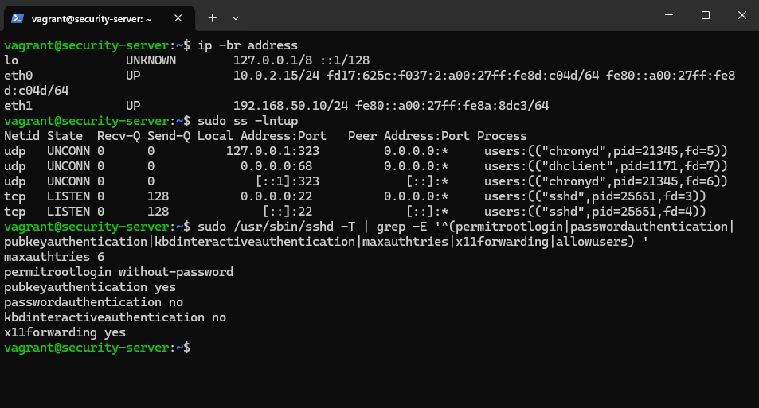
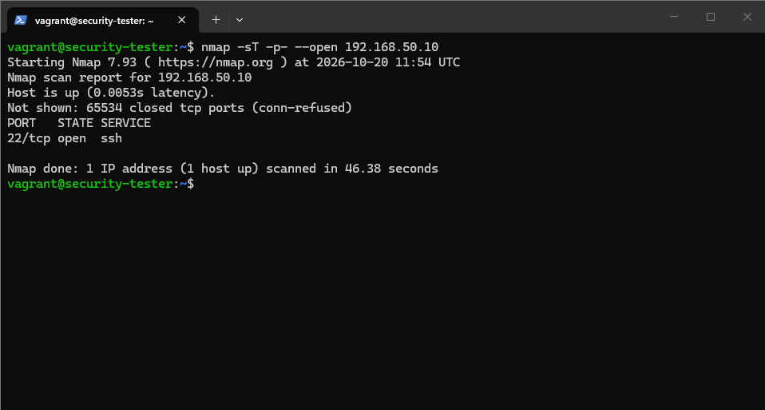
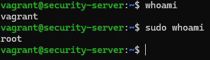
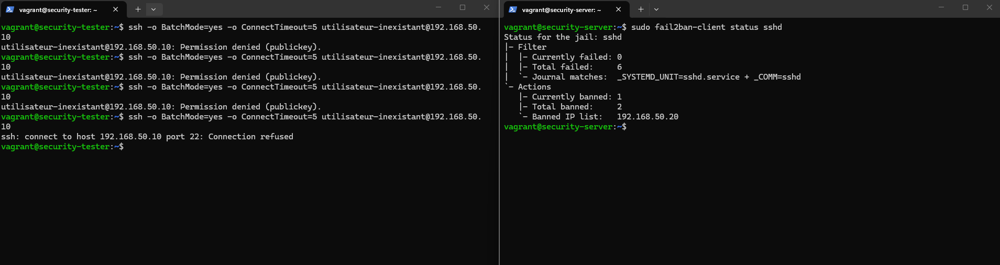
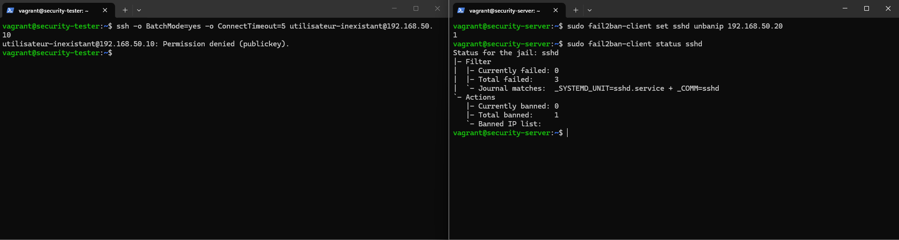
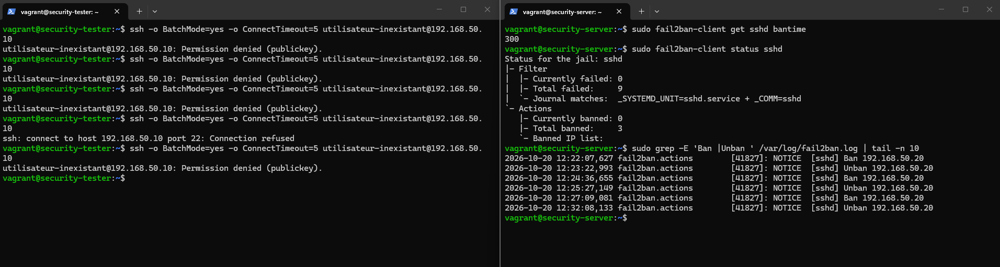

# Absicherung und Überwachung eines Debian-Servers

## 1. Projektvorstellung

### 1.1 Ausgangslage

Dieses Projekt umfasst die Absicherung und Überwachung eines Debian-Servers in einer virtualisierten Laborumgebung. Dabei werden die in den Unterlagen des Moduls Cyber Security behandelten Sicherheitskonzepte angewendet, insbesondere die Systemhärtung, der Schutz von SSH-Zugängen, die Protokollierung und die Überprüfung der Dateiintegrität.

Die Arbeit umfasst eine funktionsfähige Umsetzung, eine Dokumentation und eine Präsentation. Die Laborumgebung ermöglicht Tests auf eigens dafür vorgesehenen Maschinen sowie einen Vergleich des ursprünglichen Serverzustands mit dem Zustand nach der Absicherung.

Das Projekt befasst sich mit der Konfiguration und Bewertung der Sicherheitsmassnahmen.

### 1.2 Fragestellung

Wie lässt sich die Sicherheit eines Debian-Servers erhöhen, sein SSH-Zugang schützen und die Änderung sensibler Dateien erkennen, während ein funktionierender Administrationszugang erhalten bleibt?

### 1.3 Übergeordnetes Ziel

Umsetzung einer Sicherheitslösung, die SSH-Härtung, Schutz vor wiederholten fehlgeschlagenen Authentifizierungsversuchen, Integritätsprüfung und Nachvollziehbarkeit von Änderungen kombiniert.

## 2. Spezifische Ziele und Validierungskriterien

Die folgenden Ziele beschreiben das erwartete Projektergebnis. Die Infrastruktur, die SSH-Härtung, Fail2ban, die Integritätsprüfung mit AIDE und die Nachvollziehbarkeit mit auditd wurden anhand der dokumentierten Szenarien überprüft. Nach einem vollständigen Herunterfahren und Neustart wurde zudem geprüft, ob die Konfigurationen und Schutzmassnahmen weiterhin wirksam waren.

| ID | Ziel | Validierungskriterium | Status |
|---|---|---|---|
| O1 | Eine Laborumgebung mit zwei Debian-VM bereitstellen | Beide VM starten, und die Testmaschine erreicht den Server über das interne Netzwerk | Bestätigt |
| O2 | Den Ausgangszustand des Servers erfassen | Schnittstellen, erreichbare TCP-Ports und die wichtigsten SSH-Parameter sind erfasst | Bestätigt |
| O3 | Vor Änderungen einen Wiederherstellungspunkt bereitstellen | Snapshot des Ausgangszustands erstellt; die Wiederherstellung wurde noch nicht getestet | Snapshot erstellt |
| O4 | Die SSH-Konfiguration härten | Direkte Anmeldung als root verboten, X11 deaktiviert, Anzahl der Authentifizierungsversuche reduziert und Administrationszugang per Schlüssel überprüft | Bestätigt |
| O5 | SSH mit Fail2ban schützen | Erkannte fehlgeschlagene Authentifizierungsversuche lösen eine vorübergehende Sperre aus; Sperrung und Aufhebung sind überprüft | Bestätigt |
| O6 | Die Integrität mit AIDE prüfen | Eine kontrollierte Änderung einer überwachten Datei wird bei einer Prüfung gemeldet | Bestätigt |
| O7 | Änderungen mit auditd nachvollziehen | Eine Änderung an einer überwachten Datei erzeugt ein Ereignis, anhand dessen sich die Aktion und der Benutzerkontext identifizieren lassen | Bestätigt |
| O8 | Die Funktionsweise der Schutzmassnahmen überprüfen | Erwartete und beobachtete Ergebnisse werden mit Nachweisen und Einschränkungen verglichen | Für die dokumentierten Szenarien bestätigt |
| O9 | Die Lösung dokumentieren und präsentieren | Architektur, Entscheidungen, Konfigurationen, Tests und Fazit sind erläutert | In Bearbeitung |

## 3. Projektumfang

### 3.1 Enthaltene Elemente

- Ein abzusichernder Debian-Server.
- Eine für Tests vorgesehene Debian-Maschine.
- Die Fernadministration über SSH.
- Die Härtung der für die Laborumgebung ausgewählten SSH-Parameter.
- Der Schutz der SSH-Zugänge mit Fail2ban.
- Die Überwachung einer begrenzten Auswahl von Dateien mit AIDE und auditd.
- Die Untersuchung von Sicherheitsereignissen in den verfügbaren Protokollen.
- Der Vorher-Nachher-Vergleich, die Dokumentation und eine Demonstration.

## 4. Werkzeuge und Bezug zum Unterricht

| Werkzeug | Aufgabe | Stand im Projekt |
|---|---|---|
| VirtualBox | Betrieb der VM | Eingesetzt |
| Vagrant | Definition, Start und Zugriff auf die VM | Eingesetzt |
| Debian 12, Box `debian/bookworm64` | Betriebssystem beider Maschinen | Eingesetzt |
| OpenSSH | Fernadministration des Servers | Gehärtet; Zugriff überprüft |
| Nmap | Überprüfung der erreichbaren TCP-Ports | Auf `tester` eingesetzt |
| Fail2ban | Erkennung fehlgeschlagener Authentifizierungsversuche und vorübergehende Sperrung | Konfiguriert und getestet |
| AIDE | Vergleich der Dateien mit einer Integritätsreferenz | Konfiguriert; Tests und Prüfung nach dem Neustart bestätigt |
| auditd | Audit der Aktionen an den ausgewählten Dateien | Konfiguriert; Nachvollziehbarkeit und erneutes Laden der Regeln bestätigt |
| journald | Von Fail2ban mit dem systemd-Backend verwendetes SSH-Protokoll | Verwendet und überprüft |
| rsyslog | Allfällige ergänzende Protokollierung | Konfiguration nicht überprüft |
| nftables | Von Fail2ban angeforderte Sperren | Von der konfigurierten Sperraktion verwendet |

## 5. Architektur der Laborumgebung

### 5.1 Virtuelle Maschinen

| Vagrant-Kennung | Systemname | Adresse im internen Netzwerk | Zugewiesene Ressourcen | Funktion |
|---|---|---|---|---|
| `server` | `security-server` | `192.168.50.10/24` | 1 vCPU, 1 024 MB RAM | Abzusichernder Server |
| `tester` | `security-tester` | `192.168.50.20/24` | 1 vCPU, 1 024 MB RAM | Testmaschine |

### 5.2 Netzwerke und Zugänge

Das interne VirtualBox-Netzwerk heisst `debian-security-lab` und verwendet das Subnetz `192.168.50.0/24`. Es ermöglicht die Kommunikation zwischen den beiden VM für die Tests.

Jede VM verfügt ausserdem über die übliche NAT-Schnittstelle von Vagrant/VirtualBox. Diese ermöglicht insbesondere die für die Paketinstallation erforderlichen ausgehenden Verbindungen.

Das Testnetzwerk ist ein internes VirtualBox-Netzwerk. Dies bedeutet jedoch nicht, dass die VM vollständig vom übrigen Netzwerk getrennt sind: Die NAT-Schnittstelle bleibt vorhanden. Die gemeinsamen Vagrant-Ordner sind im Vagrantfile deaktiviert.

## 6. Einrichtung der Umgebung

### 6.1 Softwarevorbereitung der VM

Die folgenden Befehle wurden für die manuelle Vorbereitung der Laborumgebung bereitgestellt.

Auf `server`:

```bash
sudo apt update
sudo apt upgrade -y
sudo apt install -y openssh-server
sudo systemctl enable --now ssh
```

Auf `tester`:

```bash
sudo apt update
sudo apt install -y nmap
```





Die Bildschirmaufnahmen bestätigen, dass OpenSSH auf dem Server Verbindungen entgegennimmt und Nmap auf der Testmaschine funktioniert. Sie stellen kein Ausführungsprotokoll der einzelnen Installationsbefehle dar: Diese sind hier als Vorbereitungsanleitung festgehalten.

## 7. Ausgangszustand

### 7.1 Schnittstellen des Servers

Auf `server` ausgeführter Befehl:

```bash
ip -br address
```

| Schnittstelle | Beobachtete IPv4-Adresse | Funktion |
|---|---|---|
| `lo` | `127.0.0.1/8` | Loopback |
| `eth0` | `10.0.2.15/24` | NAT-Schnittstelle von VirtualBox |
| `eth1` | `192.168.50.10/24` | Internes Labornetzwerk |

In der Ausgabe erscheinen auch IPv6-Adressen. Der nachfolgend dargestellte Nmap-Scan bezieht sich ausschliesslich auf die IPv4-Adresse `192.168.50.10`.

### 7.2 Lauschende Dienste auf dem Server

Ausgeführter Befehl:

```bash
sudo ss -lntup
```

| Protokoll | Beobachtete Adresse und Port | Prozess | Interpretation |
|---|---|---|---|
| TCP | `0.0.0.0:22` und `[::]:22` | `sshd` | SSH lauscht auf den IPv4- und IPv6-Adressen des Servers |
| UDP | `127.0.0.1:323` und `[::1]:323` | `chronyd` | Steuerungsport |
| UDP | `0.0.0.0:68` | `dhclient` | DHCP-Client |

Ein lokal lauschender Dienst ist nicht zwangsläufig aus der Ferne erreichbar. Der Befehl `ss` beschreibt den lokalen Zustand; der Scan von `tester` ergänzt diese Erfassung durch eine Beobachtung aus dem Netzwerk.

### 7.3 Überprüfung des SSH-Dienstes von tester aus

Ausgeführter Befehl:

```bash
nmap -sT -sV -p 22 192.168.50.10
```

Der Scan identifizierte den offenen Port `22/tcp` und den folgenden Dienst:

```text
OpenSSH 9.2p1 Debian 2+deb12u10 (protocol 2.0)
```

Dies ist die zu diesem Zeitpunkt von Nmap gemeldete Identifikation und kein Nachweis dafür, dass keine Sicherheitslücken vorhanden sind.

### 7.4 Scan aller TCP-Ports

Von `tester` aus ausgeführter Befehl:

```bash
nmap -sT -p- --open 192.168.50.10
```

Bereitgestelltes Ergebnis:

```text
Nmap scan report for 192.168.50.10
Host is up (0.0053s latency).
Not shown: 65534 closed tcp ports (conn-refused)
PORT   STATE SERVICE
22/tcp open  ssh

Nmap done: 1 IP address (1 host up) scanned in 46.38 seconds
```

Interpretation:

- Der Server ist von der Testmaschine aus erreichbar.
- Der Scan hat die TCP-Ports 1 bis 65 535 untersucht.
- Von dieser Maschine aus und unter dieser Adresse erscheint nur TCP-Port 22 als offen.
- Die übrigen 65 534 TCP-Ports werden als geschlossen gemeldet; Verbindungsversuche werden zurückgewiesen.
- Der Scan deckt weder UDP-Ports noch die Erreichbarkeit über IPv6 ab.

Diese Beobachtung dient als Referenz für spätere Vergleiche. Sie belegt weder das Vorhandensein einer restriktiven Firewall noch die Sicherheit der SSH-Konfiguration.

### 7.5 Wirksame SSH-Konfiguration

Auf dem Server ausgeführter Befehl:

```bash
sudo /usr/sbin/sshd -T | grep -E '^(permitrootlogin|passwordauthentication|pubkeyauthentication|kbdinteractiveauthentication|maxauthtries|x11forwarding|allowusers) '
```

Beobachtetes Ergebnis:

```text
maxauthtries 6
permitrootlogin without-password
pubkeyauthentication yes
passwordauthentication no
kbdinteractiveauthentication no
x11forwarding yes
```

| Parameter | Ausgangswert | Analyse |
|---|---|---|
| `PermitRootLogin` | `without-password` | Die direkte Anmeldung als root ist nicht vollständig verboten; eine Schlüsselauthentifizierung bleibt möglich, sofern ein autorisierter Schlüssel konfiguriert ist |
| `PubkeyAuthentication` | `yes` | Die Authentifizierung mit öffentlichem Schlüssel ist aktiviert |
| `PasswordAuthentication` | `no` | Die SSH-Authentifizierung mit Passwort ist deaktiviert |
| `KbdInteractiveAuthentication` | `no` | Die interaktive Tastaturauthentifizierung ist deaktiviert |
| `MaxAuthTries` | `6` | Pro Verbindung sind höchstens sechs Authentifizierungsversuche erlaubt |
| `X11Forwarding` | `yes` | Die grafische X11-Weiterleitung ist erlaubt |
| `AllowUsers` | Keine Zeile ausgegeben | In dieser Ausgabe erscheint keine einschränkende Benutzerliste |

In der Ausgangskonfiguration sind Passwörter bereits deaktiviert. Im Projekt müssen diese bereits vorhandenen Schutzmassnahmen von den tatsächlich hinzugefügten Massnahmen unterschieden werden.

Der Befehl `sshd -T` zeigt die allgemein wirksame Konfiguration an.

## 8. Wiederherstellungspunkt

Vor der Härtung wurde ein Snapshot des aktuellen Zustands erstellt.

Dieser ermöglicht es, bei Problemen zum Ausgangszustand zurückzukehren oder bestimmte Tests zu wiederholen. Der genaue Name des Snapshots lautet `avant-hardening`.

Die Wiederherstellung des Snapshots wurde noch nicht getestet. Der Snapshot bewahrt den Referenzzustand vor den in den folgenden Abschnitten beschriebenen Änderungen an SSH und Fail2ban.

## 9. Bilanz der anfänglichen Überprüfungen

| ID | Überprüfung | Beobachtetes Ergebnis | Schlussfolgerung |
|---|---|---|---|
| T01 | Vagrant-Status | `server` und `tester` sind `running` | Beide VM funktionieren |
| T02 | Verbindung von tester zum Server | Nmap meldet den Server als erreichbar | Die Kommunikation im Testnetzwerk funktioniert |
| T03 | SSH-Port | `22/tcp open` | Der SSH-Dienst ist erreichbar |
| T04 | Vollständiger TCP-Scan | Ein offener Port und 65 534 geschlossene Ports | SSH ist der einzige unter der getesteten Adresse beobachtete offene TCP-Dienst |
| T05 | Serverschnittstellen | NAT und internes Netzwerk vorhanden | Die Serveradresse entspricht dem Netzwerkplan |
| T06 | SSH-Konfiguration | Parameter mit `sshd -T` erfasst | Eine Referenz vor der Härtung ist verfügbar |

## 10. SSH-Härtung

### 10.1 Ziele und Vorher-Nachher-Vergleich

Die Härtung soll die direkte Anmeldung als root verbieten, die Anzahl der Authentifizierungsversuche pro Verbindung reduzieren und die grafische X11-Weiterleitung deaktivieren, die für diesen über die Kommandozeile administrierten Server nicht benötigt wird.

| Parameter | Ausgangszustand | Zustand nach der Härtung | Wirkung |
|---|---|---|---|
| `PermitRootLogin` | `without-password` | `no` | Direkte SSH-Anmeldung als root verboten |
| `PubkeyAuthentication` | `yes` | `yes` | Schlüsselauthentifizierung beibehalten |
| `PasswordAuthentication` | `no` | `no` | Verbot von SSH-Passwörtern beibehalten |
| `KbdInteractiveAuthentication` | `no` | `no` | Deaktivierung der interaktiven Tastaturauthentifizierung beibehalten |
| `MaxAuthTries` | `6` | `3` | Anzahl der Authentifizierungsversuche pro Verbindung reduziert |
| `X11Forwarding` | `yes` | `no` | Grafische X11-Weiterleitung deaktiviert |

Passwörter waren bereits vor dem Projekt deaktiviert. Dieser Schutz wurde beibehalten; er stellt keine während der Härtung neu hinzugefügte Massnahme dar.

### 10.2 Separate Konfigurationsdatei

Auf `server` wurde die folgende Datei erstellt:

```bash
sudo nano /etc/ssh/sshd_config.d/00-lab-hardening.conf
```

Inhalt:

```text
PermitRootLogin no
PubkeyAuthentication yes
PasswordAuthentication no
KbdInteractiveAuthentication no
MaxAuthTries 3
X11Forwarding no
```

Die separate Datei fasst die Parameter der Laborumgebung zusammen. Die Überprüfung der wirksamen Konfiguration ist erforderlich, um die tatsächlich übernommenen Werte zu bestätigen.

### 10.4 Validierung der Konfiguration

Syntaxprüfung:

```bash
sudo /usr/sbin/sshd -t
```

Anschliessend wurde die wirksame Konfiguration überprüft:

```bash
sudo /usr/sbin/sshd -T | grep -E '^(permitrootlogin|pubkeyauthentication|passwordauthentication|kbdinteractiveauthentication|maxauthtries|x11forwarding) '
```

Tatsächlich übermitteltes Ergebnis:

```text
maxauthtries 3
permitrootlogin no
pubkeyauthentication yes
passwordauthentication no
kbdinteractiveauthentication no
x11forwarding no
```

Die sechs Werte entsprechen der gewünschten Konfiguration.

### 10.4 Anwendung und Erhalt des Administrationszugangs

Nach erfolgreicher Syntaxprüfung wurde die Konfiguration wie folgt angewendet:

```bash
sudo /usr/sbin/sshd -t && sudo systemctl reload ssh
```

In einem zweiten PowerShell-Fenster wurde eine neue Verbindung aufgebaut:

```powershell
vagrant ssh server
```

Anschliessend wurden die Benutzeridentitäten überprüft:

```bash
whoami
sudo whoami
```



Erwartete Ergebnisse des Vorgehens, dessen Durchführung vom Autor bestätigt wurde: zuerst `vagrant`, danach `root`. Der Administrationszugang blieb nach dem Neuladen erhalten.

## 11. SSH-Schutz mit Fail2ban

### 11.1 Ziel

Fail2ban analysiert SSH-Ereignisse und löst eine vorübergehende Sperre aus, wenn innerhalb eines festgelegten Zeitraums mehrere erkannte fehlgeschlagene Authentifizierungsversuche von derselben IP-Adresse ausgehen.

Dieser Schutz ergänzt die SSH-Härtung: `MaxAuthTries` begrenzt die Versuche innerhalb einer Verbindung, während Fail2ban Ereignisse aus mehreren aufeinanderfolgenden Verbindungen zählen kann.

### 11.2 Installation auf server

```bash
sudo apt update
sudo apt install -y fail2ban python3-systemd nftables
```

| Paket | Funktion |
|---|---|
| `fail2ban` | Analyse fehlgeschlagener Versuche und Verwaltung der Sperren |
| `python3-systemd` | Zugriff auf das systemd-Journal durch Fail2ban |
| `nftables` | Anwendung der von Fail2ban angeforderten Sperrregeln |

Fail2ban ist auf `server` installiert. Für die Durchführung der Tests ist keine Installation auf `tester` erforderlich.

### 11.3 Konfiguration der SSH-Jail

Erstellte Datei:

```bash
sudo nano /etc/fail2ban/jail.d/sshd.local
```

Inhalt:

```ini
[sshd]
enabled = true
backend = systemd
port = 22
filter = sshd
banaction = nftables-multiport

maxretry = 3
findtime = 5m
bantime = 5m

ignoreip = 127.0.0.1/8 ::1 10.0.2.2
```

| Parameter | Begründung |
|---|---|
| `backend = systemd` | SSH-Ereignisse aus dem systemd-Journal auswerten |
| `port = 22` | Den in der Laborumgebung verwendeten SSH-Port schützen |
| `filter = sshd` | Den von Fail2ban bereitgestellten SSH-Filter verwenden |
| `banaction = nftables-multiport` | Sperren mit nftables auf den konfigurierten Ports anwenden |
| `maxretry = 3` | Nach drei erkannten fehlgeschlagenen Versuchen innerhalb des Suchzeitfensters eine Sperre auslösen |
| `findtime = 5m` | Ereignisse innerhalb eines Zeitraums von fünf Minuten zählen |
| `bantime = 5m` | Für ungefähr fünf Minuten vorübergehend sperren |
| `ignoreip` | Loopback und die NAT-Adresse für die Administration ausnehmen |

Die Ausnahme für `10.0.2.2` soll den Administrationszugang über das VirtualBox-NAT erhalten.

### 11.4 Validierung und Start

```bash
sudo fail2ban-client -t
```

Beobachtetes Ergebnis:

```text
WARNING 'allowipv6' not defined in 'Definition'. Using default one: 'auto'
OK: configuration test is successful
```

Die Warnung weist darauf hin, dass für `allowipv6` der Standardwert `auto` verwendet wird. Sie hat weder die Validierung noch den Start verhindert. Die hier durchgeführten Tests betreffen IPv4.

Aktivierung beim Systemstart und Start des Dienstes:

```bash
sudo systemctl enable fail2ban
sudo systemctl restart fail2ban
systemctl is-active fail2ban
sudo fail2ban-client status sshd
```

Der Dienst meldete `active`. Die Jail `sshd` zeigte anfänglich für fehlgeschlagene Versuche und Sperren jeweils den Zählerstand null an.

## 12. Tests des Fail2ban-Schutzes

### 12.1 Testbedingungen

| Element | Wert |
|---|---|
| Quellmaschine | `tester`, Adresse `192.168.50.20` |
| Geschützte Maschine | `server`, Adresse `192.168.50.10` |
| Dienst | SSH, TCP 22 |
| Für den Test verwendete Identität | `utilisateur-inexistant` |
| Passwortauthentifizierung | Während der Tests deaktiviert |
| Fail2ban-Schwellenwert | Drei erkannte fehlgeschlagene Versuche innerhalb von fünf Minuten |
| Konfigurierte Sperrdauer | 300 Sekunden |

Das Szenario überprüft fehlgeschlagene Authentifizierungsversuche mit einem nicht existierenden Benutzer, ohne Passwörter wieder zu aktivieren. Es handelt sich nicht um einen Test zum Erraten eines Passworts. Die Anzahl der erkannten Ereignisse darf nicht grundsätzlich mit der Anzahl der ausgeführten SSH-Befehle gleichgesetzt werden.

### 12.2 Erkennung und Sperrung

Von `tester` aus mehrfach manuell ausgeführter Befehl:

```bash
ssh admin@192.168.50.10
```

Auf `server` wurde die folgende Überprüfung durchgeführt:

```bash
sudo fail2ban-client status sshd
```

Bei der ersten Sperrung beobachtetes Ergebnis:

```text
Currently failed: 0
Total failed: 3
Currently banned: 1
Total banned: 1
Banned IP list: 192.168.50.20
```

Ein erneuter Versuch von `tester` aus führte anschliessend zu folgender Ausgabe:

```text
ssh: connect to host 192.168.50.10 port 22: Connection refused
```



Der Wechsel von `Permission denied (publickey)` zu `Connection refused` bestätigt zusammen mit dem Eintrag der IP-Adresse in der Fail2ban-Liste die beobachtete Netzwerksperre.

### 12.3 Manuelle Aufhebung der Sperre

Auf `server`:

```bash
sudo fail2ban-client set sshd unbanip 192.168.50.20
sudo fail2ban-client status sshd
```

Beobachtetes Ergebnis:

```text
Currently banned: 0
Total banned: 1
Banned IP list:
```



Die Liste ist leer, während der historische Zähler `Total banned` die erfolgte Sperrung weiterhin erfasst.

Ein einzelner erneuter Versuch von `tester` aus ergab wieder:

```text
Permission denied (publickey).
```

Die Netzwerksperre wurde somit aufgehoben. Für den nicht existierenden Benutzer ist der Authentifizierungsfehler weiterhin zu erwarten.

### 12.5 Automatische Aufhebung nach Ablauf der Sperrdauer

Auf `server` wurde die konfigurierte Dauer überprüft:

```bash
sudo fail2ban-client get sshd bantime
```

Ergebnis:

```text
300
```

Von `tester` aus wurde eine weitere Sperre ausgelöst. Nach einer Wartezeit von mehr als fünf Minuten ohne manuellen Entsperrbefehl zeigte die Jail erneut `Currently banned: 0` und eine leere Liste an. Ein erneuter SSH-Versuch erreichte die Authentifizierung und führte zu `Permission denied (publickey)`.

Die Ereignisse wurden auf `server` mit folgendem Befehl ausgelesen:

```bash
sudo grep -E 'Ban |Unban ' /var/log/fail2ban.log | tail -n 10
```

Letztes in der Bildschirmaufnahme sichtbares Ereignispaar:

```text
2026-10-20 12:27:09,081 ... [sshd] Ban 192.168.50.20
2026-10-20 12:32:08,133 ... [sshd] Unban 192.168.50.20
```

Der Abstand beträgt ungefähr 299 Sekunden, also rund fünf Minuten, und stimmt mit der konfigurierten Dauer von 300 Sekunden überein. Die anderen in dieser Aufnahme sichtbaren `Ban`-/`Unban`-Paare stammen aus früheren Tests; sie entsprechen nicht alle automatisch abgelaufenen Sperren von fünf Minuten.



### 12.6 Hinweis zur Ausführungsmaschine

Die SSH-Versuche werden auf `tester` ausgeführt, während die Befehle mit `fail2ban-client` auf `server` ausgeführt werden, wo Fail2ban installiert ist. Die auf `tester` beobachtete Fehlermeldung `command not found` weist daher nicht auf eine Fehlfunktion des geschützten Servers hin.

## 13. Bilanz der Tests nach der Härtung

| ID | Überprüfung | Erwartetes Ergebnis | Beobachtetes Ergebnis | Status |
|---|---|---|---|---|
| T08 | Wirksame SSH-Parameter | Werte aus der Härtungsdatei übernommen | Die sechs erwarteten Werte werden von `sshd -T` ausgegeben | Bestätigt |
| T09 | Neue Administrationsverbindung | Zugriff mit `vagrant ssh server` und Rechteerhöhung mit `sudo` | Durchführung bestätigt | Bestätigt |
| T10 | Fail2ban-Konfiguration | Erfolgreicher Konfigurationstest | `OK: configuration test is successful` | Bestätigt |
| T11 | Dienst und SSH-Jail | Dienst aktiv und Jail funktionsfähig | `active`, Jail `sshd` und Zuordnung zum systemd-Journal | Bestätigt |
| T12 | Fehlgeschlagene Authentifizierungsversuche | Vom SSH-Filter erkannte Ereignisse | `Total failed: 3` bei der ersten Sperrung | Bestätigt |
| T13 | Sperrung von tester | IP-Adresse in der Sperrliste vorhanden | `192.168.50.20`, `Currently banned: 1` | Bestätigt |
| T14 | Netzwerksperre nach der Sperrung | Verbindung vor der Authentifizierung unterbrochen | `Connection refused` | Bestätigt |
| T15 | Manuelle Aufhebung | Leere Liste und erneuter Zugang zur Authentifizierung | `Currently banned: 0`, danach `Permission denied (publickey)` | Bestätigt |
| T16 | Konfigurierte Dauer | 300 Sekunden | Von Fail2ban ausgegebener Wert `300` | Bestätigt |
| T17 | Automatische Aufhebung | Entsperrung nach ungefähr fünf Minuten ohne Eingriff | `Ban`-/`Unban`-Paar mit ungefähr fünf Minuten Abstand und erneuter Zugang zur Authentifizierung | Bestätigt |

Die Tests bestätigen das in der Laborumgebung durchgeführte IPv4-Szenario.

## 14. Integritätsprüfung mit AIDE

### 14.1 Ziel und Installation

AIDE vergleicht die überwachten Dateien mit einer Referenzdatenbank. Bei einer manuellen Prüfung lassen sich Unterschiede im Inhalt und in den Metadaten erkennen. AIDE verhindert keine Änderungen und stellt in dieser Konfiguration keine kontinuierliche Überwachung dar.

Installation auf `server`:

```bash
sudo apt update
sudo apt install -y aide
sudo aide --version
ls -l /etc/aide/
```

Beobachtete Version: **AIDE 0.18.3**. Das Verzeichnis `/etc/aide/` enthält unter anderem `aide.conf`, `aide.conf.d` und `aide.settings.d`.

Die installierte Version zeigt in ihren einkompilierten Standardwerten `config file: <none>`, `database_in: <none>` und `database_out: <none>` an. Die Laborkonfiguration wird daher bei jedem Befehl ausdrücklich angegeben.

### 14.2 Laborkonfiguration

Es wurde eine von der mitgelieferten Debian-Konfiguration unabhängige Datei erstellt:

```bash
sudo nano /etc/aide/aide-lab.conf
```

Inhalt:

```text
# Bases de reference du laboratoire
database_in=file:/var/lib/aide/aide-lab.db
database_out=file:/var/lib/aide/aide-lab.db.new
gzip_dbout=no

# Rapport affiche dans le terminal
report_url=stdout
report_level=changed_attributes

# Attributs surveilles
LAB = p+u+g+ftype+s+m+c+sha256

# Repertoires surveilles
/etc/ssh(/.*)?$ LAB
/etc/fail2ban(/.*)?$ LAB

# Configuration de surveillance elle-meme
/etc/aide/aide-lab[.]conf$ LAB
```

| Attribut | Überprüfung |
|---|---|
| `p` | Berechtigungen |
| `u`, `g` | Eigentümer und Gruppe |
| `ftype` | Dateityp |
| `s` | Grösse |
| `m` | Zeitpunkt der letzten Inhaltsänderung (`mtime`) |
| `c` | Zeitpunkt der Änderung der Metadaten (`ctime`) |
| `sha256` | Hashwert des Inhalts |

Der Überwachungsumfang umfasst die SSH-Konfiguration, die Fail2ban-Konfiguration und die AIDE-Konfigurationsdatei der Laborumgebung. Die AIDE-Datenbanken und die Protokolle sind in diesen Regeln nicht enthalten.

### 14.3 Erstellung der Referenz

Syntaxprüfung und Initialisierung:

```bash
sudo aide --config=/etc/aide/aide-lab.conf --config-check
sudo mkdir -p /var/lib/aide
sudo aide --config=/etc/aide/aide-lab.conf --init
```

Der Befehl `--init` erzeugt die Ausgabedatenbank `aide-lab.db.new`. Diese Datenbank wurde anschliessend als Referenz aktiviert:

```bash
sudo cp /var/lib/aide/aide-lab.db.new /var/lib/aide/aide-lab.db
sudo chmod 600 /var/lib/aide/aide-lab.db /var/lib/aide/aide-lab.db.new
```

Erste Prüfung:

```bash
sudo aide --config=/etc/aide/aide-lab.conf --check
```

Am 22. Oktober 2026 um **09:50:26 UTC** beobachtetes Ergebnis:

```text
AIDE found NO differences between database and filesystem. Looks okay!!
Number of entries: 188
```

Dieser Schritt bestätigt, dass die Referenz dem Zustand der Dateien zu Beginn des Tests entspricht.

## 15. Erkennungs- und Wiederherstellungstest mit AIDE

### 15.1 Kontrollierte Änderung

Die SSH-Datei wurde unter `/root` und damit ausserhalb des überwachten Bereichs gesichert:

```bash
sudo cp -a /etc/ssh/sshd_config.d/00-lab-hardening.conf /root/00-lab-hardening.conf.avant-test-aide
```

Es wurde ein Kommentar hinzugefügt, ohne die Sicherheitsparameter zu ändern:

```bash
echo '# Test AIDE : modification controlee' | sudo tee -a /etc/ssh/sshd_config.d/00-lab-hardening.conf
sudo /usr/sbin/sshd -t
```

Eine erneute AIDE-Prüfung wurde durchgeführt, ohne die Referenz zu ändern:

```bash
sudo aide --config=/etc/aide/aide-lab.conf --check
```

Um **09:51:47 UTC** beobachtetes Ergebnis:

```text
AIDE found differences between database and filesystem!!
Total number of entries: 188
Added entries: 0
Removed entries: 0
Changed entries: 1
```

| Element | Referenz | Geänderter Zustand |
|---|---|---|
| Datei | `/etc/ssh/sshd_config.d/00-lab-hardening.conf` | Dieselbe Datei |
| Grösse | 134 Byte | 171 Byte |
| `mtime` | 20.10.2026 um 12:11:54 UTC | 22.10.2026 um 09:51:25 UTC |
| `ctime` | 20.10.2026 um 12:11:54 UTC | 22.10.2026 um 09:51:25 UTC |
| SHA-256 | Referenzhashwert | Abweichender Hashwert |

Es wurde genau eine geänderte Datei erkannt, ohne hinzugefügte oder gelöschte Dateien. Die Inhaltsänderung wurde somit erkannt.

### 15.2 Wiederherstellung der Datei

```bash
sudo cp -a /root/00-lab-hardening.conf.avant-test-aide /etc/ssh/sshd_config.d/00-lab-hardening.conf
sudo cmp /root/00-lab-hardening.conf.avant-test-aide /etc/ssh/sshd_config.d/00-lab-hardening.conf
sudo /usr/sbin/sshd -t
sudo aide --config=/etc/aide/aide-lab.conf --check
```

Die Prüfung vom **22. Oktober um 09:54:06 UTC** meldete nur noch einen Unterschied beim `ctime`, der von `20.10.2026 12:11:54` auf `22.10.2026 09:53:35` gewechselt hatte.

Die Grösse, der SHA-256-Hashwert und die übrigen überwachten Attribute entsprachen der Referenz. Der ursprüngliche Inhalt war somit wiederhergestellt. Der Unterschied beim `ctime` ist zu erwarten: Die Wiederherstellung selbst stellt einen Eingriff an der Datei dar. `cp -a` kann den `mtime` erhalten, stellt jedoch den ursprünglichen `ctime` nicht wieder her.

### 15.3 Kontrollierte Aktualisierung der Referenz

Die bisherige Datenbank wurde gesichert. Nach der Analyse des Unterschieds wurde eine aktualisierte Datenbank erzeugt:

```bash
sudo cp -a /var/lib/aide/aide-lab.db /root/aide-lab.db.avant-actualisation
sudo aide --config=/etc/aide/aide-lab.conf --update
```

Nach der Bestätigung, dass nur der erwartete `ctime` abwich, wurde die neue Datenbank aktiviert:

```bash
sudo cp /var/lib/aide/aide-lab.db.new /var/lib/aide/aide-lab.db
sudo chmod 600 /var/lib/aide/aide-lab.db
sudo aide --config=/etc/aide/aide-lab.conf --check
```

Die Prüfung um **09:55:49 UTC** bestätigte, dass bei den 188 Einträgen keine Unterschiede vorhanden waren. Die Referenz wurde nicht aktualisiert, um den Testkommentar zu akzeptieren: Zuerst wurde der ursprüngliche Inhalt wiederhergestellt und überprüft.

## 16. Nachvollziehbarkeit von Vorgängen mit auditd

### 16.1 Ziel und Installation

auditd zeichnet Ereignisse auf, anhand deren sich Vorgänge an den überwachten Dateien analysieren lassen. Es ergänzt AIDE um den Kontext des Vorgangs: verwendetes Programm, Anmeldeidentität, effektive Identität und Zeitpunkt. Mit den hier gewählten Regeln verhindert es keine Vorgänge.

Installation und Überprüfung auf `server`:

```bash
sudo apt update
sudo apt install -y auditd
sudo systemctl enable --now auditd
systemctl is-active auditd
sudo auditctl -s
sudo auditctl -l
```

Die anfängliche Statusausgabe des Audit-Subsystems enthielt insbesondere:

```text
enabled 1
pid 27959
lost 0
backlog 0
```

Es waren noch keine Regeln geladen: `auditctl -l` gab `No rules` zurück.

### 16.2 Persistente Regeln

Die folgende Datei wurde erstellt:

```bash
sudo nano /etc/audit/rules.d/50-security-lab.rules
```

Inhalt:

```text
# Modifications de la configuration SSH
-w /etc/ssh/ -p wa -k ssh_config

# Modifications de la configuration Fail2ban
-w /etc/fail2ban/ -p wa -k fail2ban_config

# Modifications de la configuration AIDE
-w /etc/aide/ -p wa -k aide_config
```

| Option | Aufgabe |
|---|---|
| `-w` | Festlegung des überwachten Pfads |
| `-p w` | Überwachung von Schreibvorgängen |
| `-p a` | Überwachung von Attributänderungen |
| `-k` | Kennzeichnung für die Suche nach Ereignissen |

Die Regeln überwachen die betreffenden Verzeichnisse und ihre Unterverzeichnisse unter Berücksichtigung der Einschränkungen des Audit-Mechanismus beim Überschreiten von Einhängepunkten. Der Überwachungsumfang von AIDE ist für die eigene Konfiguration enger gefasst: Dort ist nur `aide-lab.conf` enthalten, während auditd das Verzeichnis `/etc/aide/` überwacht.

Schutz der Datei und Laden der Regeln:

```bash
sudo chmod 600 /etc/audit/rules.d/50-security-lab.rules
sudo augenrules --load
sudo auditctl -l
sudo auditctl -s
```

Die drei Regeln wurden bestätigt:

```text
-w /etc/ssh -p wa -k ssh_config
-w /etc/fail2ban -p wa -k fail2ban_config
-w /etc/aide -p wa -k aide_config
```

## 17. Kombinierter Test mit auditd und AIDE

### 17.1 Erzeugung eines Ereignisses

Vor dem Test wurde eine neue Sicherung erstellt:

```bash
sudo cp -a /etc/ssh/sshd_config.d/00-lab-hardening.conf /root/00-lab-hardening.conf.avant-test-auditd
```

Hinzufügen eines Kommentars und Syntaxprüfung:

```bash
echo '# Test auditd : modification controlee' | sudo tee -a /etc/ssh/sshd_config.d/00-lab-hardening.conf
sudo /usr/sbin/sshd -t
```

Suche nach den Ereignissen:

```bash
sudo ausearch -k ssh_config -ts recent -i
```

### 17.2 Analyse des Audit-Ereignisses

Die Ausgabe enthielt ein Ereignis zum Laden einer Regel mit der Kennung **112** sowie das Testereignis mit der Kennung **140**, das am **22. Oktober 2026 um 10:11:25.299 UTC** aufgezeichnet wurde.

Relevante Auszüge aus Ereignis 140:

```text
type=PROCTITLE ... proctitle=tee -a /etc/ssh/sshd_config.d/00-lab-hardening.conf
type=PATH ... name=/etc/ssh/sshd_config.d/00-lab-hardening.conf
type=SYSCALL ... syscall=openat success=yes
... a2=O_WRONLY|O_CREAT|O_APPEND
... auid=vagrant uid=root euid=root
... comm=tee exe=/usr/bin/tee key=ssh_config
```

| Feld | Ergebnis | Interpretation |
|---|---|---|
| Ereigniskennung | `140` | Zusammenfassung der Einträge desselben Vorgangs |
| `name` | Pfad der SSH-Datei | Betroffene Datei |
| `exe` / `comm` | `/usr/bin/tee` / `tee` | Ausgeführtes Programm |
| `auid` | `vagrant` | Im Audit beibehaltene ursprüngliche Anmeldeidentität |
| `uid` / `euid` | `root` / `root` | Identitäten des mit `sudo` gestarteten Prozesses |
| Systemaufruf | `openat` | Öffnen der Datei |
| Flags | `O_WRONLY`, `O_CREAT`, `O_APPEND` | Öffnen zum Schreiben mit Anhängen |
| `success` | `yes` | Erfolg des beobachteten Systemaufrufs |
| `key` | `ssh_config` | Zuordnung zur SSH-Regel |

Das Ereignis zeigt das erfolgreiche Öffnen zum Schreiben mit Anhängen durch `tee`, aus einer `vagrant` zugeordneten Sitzung und mit root-Rechten. Dieser Protokolleintrag gibt den hinzugefügten Inhalt nicht wieder; die tatsächliche Inhaltsänderung wird separat mit AIDE überprüft.

### 17.3 Erkennung derselben Änderung mit AIDE

```bash
sudo aide --config=/etc/aide/aide-lab.conf --check
```

Die Prüfung vom **22. Oktober um 10:17:15 UTC** erkannte einen geänderten Eintrag unter 188 Einträgen, ohne hinzugefügte oder gelöschte Einträge.

| Attribut der SSH-Datei | Referenz | Nach dem auditd-Kommentar |
|---|---|---|
| Grösse | 134 Byte | 173 Byte |
| `mtime` | 20.10.2026 um 12:11:54 UTC | 22.10.2026 um 10:11:25 UTC |
| `ctime` | 22.10.2026 um 09:53:35 UTC | 22.10.2026 um 10:11:25 UTC |
| SHA-256 | Referenzhashwert | Abweichender Hashwert |

Der `mtime` stimmt auf die Sekunde genau mit dem Zeitpunkt des auditd-Ereignisses überein. Die beiden Werkzeuge liefern ergänzende Nachweise: AIDE erkennt die Abweichung von der Referenz, und auditd ermöglicht die Einordnung des Vorgangs in seinen Kontext.

### 17.4 Wiederherstellung eines sauberen Zustands

```bash
sudo cp -a /root/00-lab-hardening.conf.avant-test-auditd /etc/ssh/sshd_config.d/00-lab-hardening.conf
sudo cmp /root/00-lab-hardening.conf.avant-test-auditd /etc/ssh/sshd_config.d/00-lab-hardening.conf
sudo /usr/sbin/sshd -t
sudo aide --config=/etc/aide/aide-lab.conf --check
```

Das Vorgehen sieht vor, vor der Übernahme des neuen Zustands zu prüfen, ob nur der erwartete Unterschied beim `ctime` verbleibt. Anschliessend wurde die Referenz nach einer vorgängigen Sicherung aktualisiert:

```bash
sudo cp -a /var/lib/aide/aide-lab.db /root/aide-lab.db.avant-actualisation-auditd
sudo aide --config=/etc/aide/aide-lab.conf --update
```

Nach Prüfung des Berichts:

```bash
sudo cp /var/lib/aide/aide-lab.db.new /var/lib/aide/aide-lab.db
sudo chmod 600 /var/lib/aide/aide-lab.db
sudo aide --config=/etc/aide/aide-lab.conf --check
```

Das um **10:22:51 UTC** tatsächlich übermittelte Endergebnis lautete:

```text
AIDE found NO differences between database and filesystem. Looks okay!!
Number of entries: 188
```

Für die Zwischenschritte dieser zweiten Wiederherstellung liegt in den übermittelten Unterlagen keine detaillierte Ausgabe vor; die abschliessende Prüfung bestätigt die Rückkehr zu einem Zustand, der der aktivierten Referenz entspricht.

## 19. Bilanz der zusätzlichen Tests

Die Tests T01 bis T17 sind in den Abschnitten 9 und 13 aufgeführt. Die ergänzenden Überprüfungen lauten wie folgt:

| ID | Überprüfung | Beobachtetes Ergebnis | Status |
|---|---|---|---|
| T18 | Anfängliche AIDE-Referenz | Keine Unterschiede, 188 Einträge um 09:50:26 UTC | Bestätigt |
| T19 | Kontrollierte Änderung der SSH-Datei | Ein geänderter Eintrag; Grösse von 134 auf 171 Byte und abweichender SHA-256-Hashwert | Bestätigt |
| T20 | Wiederherstellung nach dem ersten Test | Nur der `ctime` weicht ab; Inhalt gemäss den überwachten Attributen wiederhergestellt | Bestätigt |
| T21 | Kontrollierte Aktualisierung der Referenz | Keine Unterschiede um 09:55:49 UTC | Bestätigt |
| T22 | Laden der auditd-Regeln | Drei Regeln vorhanden, Audit aktiviert, `lost 0` | Bestätigt |
| T23 | Nachvollziehbarkeit des Vorgangs | Ereignis 140: `tee`, SSH-Datei, `auid=vagrant`, `euid=root`, `success=yes` | Bestätigt |
| T24 | Korrelation zwischen AIDE und auditd | Eine Änderung erkannt; `mtime` stimmt mit dem Zeitpunkt des Ereignisses überein | Bestätigt |
| T25 | Abschluss des kombinierten Tests | Keine AIDE-Unterschiede um 10:22:51 UTC nach Wiederherstellung und Aktualisierung | Bestätigt |
