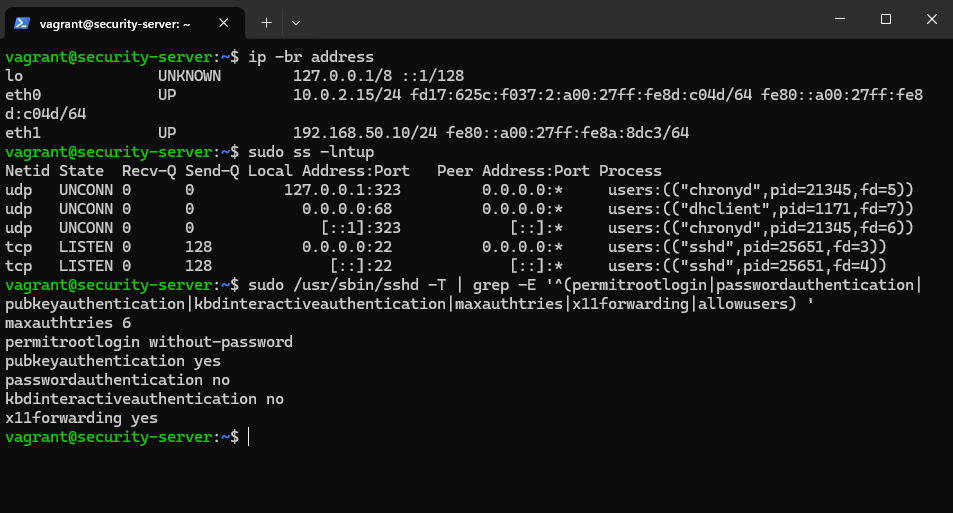
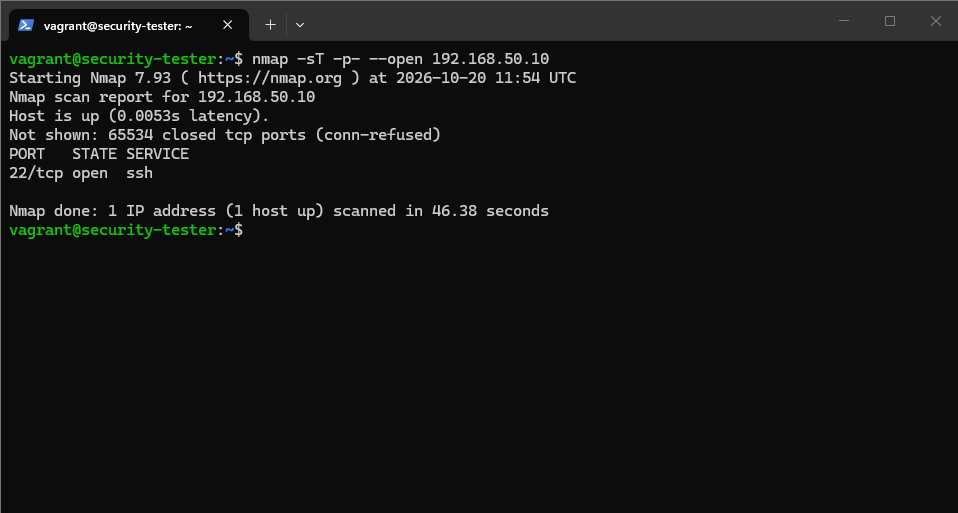
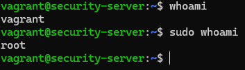
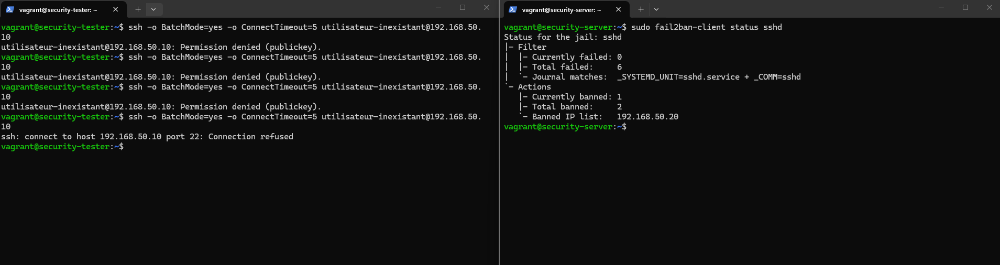
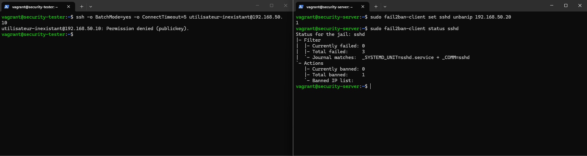
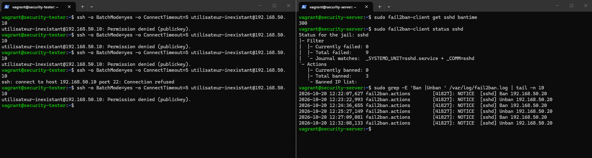

# Absicherung und Überwachung eines Debian-Servers

## 1. Présentation du projet

### 1.1 Contexte

Ce projet consiste à sécuriser et à surveiller un serveur Debian dans un laboratoire virtualisé. Il applique les notions de sécurité abordées dans les supports du module Cyber Security, notamment le hardening, la protection des accès SSH, la journalisation et le contrôle de l'intégrité des fichiers.

Le travail comprend une implémentation fonctionnelle, une documentation et une présentation. Le laboratoire permet de réaliser des tests sur des machines dédiées et de comparer l'état initial du serveur avec son état après sécurisation.

Le projet porte sur la configuration et l'évaluation des mesures de sécurité. L'automatisation, le développement de scripts et la création d'une application ne constituent pas des objectifs. Vagrant et VirtualBox servent uniquement à mettre à disposition les machines virtuelles.

### 1.2 Problématique

Comment renforcer la sécurité d'un serveur Debian, protéger son accès SSH et détecter les modifications de fichiers sensibles, tout en conservant un accès d'administration fonctionnel ?

### 1.3 Objectif général

Mettre en place une solution de sécurité associant le durcissement SSH, la protection contre les échecs d'authentification répétés, le contrôle d'intégrité et la traçabilité des modifications. L'efficacité et les limites de chaque mesure seront vérifiées par des tests documentés.

## 2. Objectifs spécifiques et critères de validation

Les objectifs suivants décrivent le résultat attendu du projet. L'infrastructure, le durcissement SSH, Fail2ban, le contrôle d'intégrité AIDE et la traçabilité auditd ont été vérifiés dans les scénarios documentés. Des contrôles de persistance ont également été réalisés après arrêt complet et redémarrage.

| ID | Objectif | Critère de validation | État |
|---|---|---|---|
| O1 | Disposer d'un laboratoire de deux VM Debian | Les deux VM démarrent et la machine de test atteint le serveur sur le réseau interne | Validé |
| O2 | Établir l'état initial du serveur | Interfaces, ports TCP accessibles et principaux paramètres SSH relevés | Validé |
| O3 | Disposer d'un point de restauration avant modification | Snapshot de l'état initial créé ; sa restauration n'a pas encore été testée | Snapshot créé |
| O4 | Renforcer la configuration SSH | Connexion directe de root interdite, X11 désactivé, limite de tentatives réduite et accès d'administration par clé vérifié | Validé |
| O5 | Protéger SSH avec Fail2ban | Des échecs d'authentification reconnus provoquent un bannissement temporaire ; le bannissement et sa levée sont vérifiés | Validé |
| O6 | Contrôler l'intégrité avec AIDE | Une modification contrôlée d'un fichier surveillé est signalée lors d'une vérification | Validé |
| O7 | Tracer des modifications avec auditd | Une modification sur un fichier surveillé produit un événement permettant d'identifier l'action et le contexte utilisateur | Validé |
| O8 | Vérifier le fonctionnement des protections | Résultats attendus et observés comparés, avec preuves et limites | Validé pour les scénarios documentés |
| O9 | Documenter et présenter la solution | Architecture, choix, configurations, tests et bilan expliqués | En cours |

## 3. Périmètre

### 3.1 Éléments inclus

- Un serveur Debian à sécuriser.
- Une machine Debian dédiée aux tests.
- L'administration distante par SSH.
- Le durcissement des paramètres SSH retenus pour le laboratoire.
- La protection des accès SSH avec Fail2ban.
- La surveillance d'un ensemble limité de fichiers avec AIDE et auditd.
- L'examen des événements de sécurité dans les journaux disponibles.
- La comparaison avant/après, la documentation et une démonstration.

### 3.2 Limites du travail

Le laboratoire ne comprend ni infrastructure de production, ni IDS réseau, ni application métier. Les tests ciblent exclusivement les VM du projet. La conformité complète à un benchmark CIS n'est pas revendiquée : chaque mesure retenue sera expliquée et testée individuellement.

Les protections ne permettront pas de garantir l'absence de toute vulnérabilité. Le projet devra préciser ce que chaque outil détecte ou bloque et ce qui reste hors de son champ d'action.

## 4. Outils et lien avec les cours

| Outil | Rôle | État dans le projet |
|---|---|---|
| VirtualBox | Hébergement des VM | Utilisé |
| Vagrant | Définition, démarrage et accès aux VM | Utilisé |
| Debian 12, box `debian/bookworm64` | Système des deux machines | Utilisé |
| OpenSSH | Administration distante du serveur | Durci ; accès vérifié |
| Nmap | Vérification des ports TCP accessibles | Utilisé sur `tester` |
| Fail2ban | Détection d'échecs d'authentification et bannissement temporaire | Configuré et testé |
| AIDE | Comparaison des fichiers avec une référence d'intégrité | Configuré ; tests et contrôle après redémarrage validés |
| auditd | Audit des actions sur les fichiers retenus | Configuré ; traçabilité et rechargement des règles validés |
| journald | Journal SSH utilisé par Fail2ban avec le backend systemd | Exploité et vérifié |
| rsyslog | Journalisation complémentaire éventuelle | Configuration non vérifiée |
| nftables | Blocages demandés par Fail2ban | Utilisé par l’action de bannissement configurée |


## 5. Architecture du laboratoire

### 5.1 Machines virtuelles

| Identifiant Vagrant | Nom système | Adresse du réseau interne | Ressources définies | Fonction |
|---|---|---|---|---|
| `server` | `security-server` | `192.168.50.10/24` | 1 vCPU, 1 024 Mo RAM | Serveur à sécuriser |
| `tester` | `security-tester` | `192.168.50.20/24` | 1 vCPU, 1 024 Mo RAM | Machine de test |


### 5.2 Réseaux et accès

Le réseau interne VirtualBox porte le nom `debian-security-lab` et utilise le sous-réseau `192.168.50.0/24`. Il permet aux deux VM de communiquer pour les tests.

Chaque VM dispose également de l'interface NAT habituelle de Vagrant/VirtualBox. Celle-ci permet notamment les connexions sortantes nécessaires à l'installation des paquets. 

Le réseau de test est interne à VirtualBox. Cela ne signifie pas que les VM sont totalement déconnectées : l'interface NAT reste présente. Les dossiers partagés Vagrant sont désactivés dans le Vagrantfile.

## 6. Mise en place de l'environnement


### 6.1 Préparation logicielle des VM

Les commandes suivantes ont été fournies pour préparer le laboratoire manuellement.

Sur `server` :

```bash
sudo apt update
sudo apt upgrade -y
sudo apt install -y openssh-server
sudo systemctl enable --now ssh
```

Sur `tester` :

```bash
sudo apt update
sudo apt install -y nmap
```



    
Les captures confirment qu'OpenSSH est à l'écoute sur le serveur et que Nmap fonctionne sur la machine de test. Elles ne constituent pas un journal d'exécution de chacune des commandes d'installation : celles-ci sont conservées ici comme procédure de préparation.

## 7. État initial 

### 7.1 Interfaces du serveur

Commande exécutée sur `server` :

```bash
ip -br address
```

| Interface | Adresse IPv4 observée | Fonction |
|---|---|---|
| `lo` | `127.0.0.1/8` | Boucle locale |
| `eth0` | `10.0.2.15/24` | Interface NAT VirtualBox |
| `eth1` | `192.168.50.10/24` | Réseau interne du laboratoire |

Des adresses IPv6 apparaissent également dans le relevé. Le scan Nmap présenté ci-dessous porte uniquement sur l'adresse IPv4 `192.168.50.10`.

### 7.2 Services en écoute sur le serveur

Commande exécutée :

```bash
sudo ss -lntup
```

| Protocole | Adresse et port observés | Processus | Interprétation |
|---|---|---|---|
| TCP | `0.0.0.0:22` et `[::]:22` | `sshd` | SSH écoute sur les adresses IPv4 et IPv6 du serveur |
| UDP | `127.0.0.1:323` et `[::1]:323` | `chronyd` | Port de commande de chrony limité à la boucle locale |
| UDP | `0.0.0.0:68` | `dhclient` | Client DHCP |

Un service en écoute localement n'est pas nécessairement accessible à distance. La commande `ss` décrit l'état local ; le scan depuis `tester` complète ce relevé par une observation réseau.

### 7.3 Vérification du service SSH depuis tester

Commande exécutée :

```bash
nmap -sT -sV -p 22 192.168.50.10
```

Le scan a identifié le port `22/tcp` ouvert et le service suivant :

```text
OpenSSH 9.2p1 Debian 2+deb12u10 (protocol 2.0)
```

Il s'agit de l'identification rapportée par Nmap à cette date, et non d'une validation de l'absence de vulnérabilités.

### 7.4 Scan de tous les ports TCP

Commande exécutée depuis `tester` :

```bash
nmap -sT -p- --open 192.168.50.10
```

Résultat fourni :

```text
Nmap scan report for 192.168.50.10
Host is up (0.0053s latency).
Not shown: 65534 closed tcp ports (conn-refused)
PORT   STATE SERVICE
22/tcp open  ssh

Nmap done: 1 IP address (1 host up) scanned in 46.38 seconds
```

Interprétation :

- Le serveur est accessible depuis la machine de test.
- Le scan a examiné les ports TCP de 1 à 65 535.
- Seul le port TCP 22 apparaît ouvert depuis cette machine et sur cette adresse.
- Les 65 534 autres ports TCP sont signalés comme fermés, avec refus de connexion.
- Le scan ne couvre ni les ports UDP ni l'accessibilité IPv6.

Cette observation fournit une référence pour les comparaisons ultérieures. Elle ne prouve ni la présence d'un pare-feu restrictif, ni la sécurité de la configuration SSH.

### 7.5 Configuration SSH effective

Commande exécutée sur le serveur :

```bash
sudo /usr/sbin/sshd -T | grep -E '^(permitrootlogin|passwordauthentication|pubkeyauthentication|kbdinteractiveauthentication|maxauthtries|x11forwarding|allowusers) '
```

Résultat observé :

```text
maxauthtries 6
permitrootlogin without-password
pubkeyauthentication yes
passwordauthentication no
kbdinteractiveauthentication no
x11forwarding yes
```

| Paramètre | Valeur initiale | Analyse |
|---|---|---|
| `PermitRootLogin` | `without-password` | La connexion directe de root n'est pas totalement interdite ; une authentification par clé reste possible si une clé autorisée est configurée |
| `PubkeyAuthentication` | `yes` | L'authentification par clé publique est activée |
| `PasswordAuthentication` | `no` | L'authentification SSH par mot de passe est désactivée |
| `KbdInteractiveAuthentication` | `no` | L'authentification interactive clavier est désactivée |
| `MaxAuthTries` | `6` | Six tentatives d'authentification au maximum sont autorisées par connexion |
| `X11Forwarding` | `yes` | Le transfert graphique X11 est autorisé |
| `AllowUsers` | Aucune ligne retournée | Aucune liste restrictive d'utilisateurs n'apparaît dans cette sortie |

La configuration initiale désactive déjà les mots de passe. Le projet devra distinguer ces protections préexistantes des mesures réellement ajoutées.

La commande `sshd -T` donne la configuration effective générale. Des blocs `Match` éventuels peuvent produire des différences selon l'utilisateur ou l'origine de la connexion ; leur présence devra être examinée si nécessaire lors du durcissement.

## 8. Point de restauration

Un snapshot de l'état actuel a été créé avant le durcissement, conformément à la confirmation de l'auteur du projet.

Il permettra de revenir à la situation initiale en cas de problème ou de reproduire certains tests. Le nom exact du snapshot et les VM couvertes devront être reportés depuis Vagrant ou VirtualBox dans la version finale du document.

La restauration du snapshot n'a pas encore été testée. Le snapshot conserve la référence avant les modifications SSH et Fail2ban présentées dans les sections suivantes.

## 9. Bilan des vérifications initiales

| ID | Vérification | Résultat observé | Conclusion |
|---|---|---|---|
| T01 | État Vagrant | `server` et `tester` sont `running` | Les deux VM fonctionnent |
| T02 | Connexion au serveur depuis tester | Nmap signale le serveur accessible | La communication sur le réseau de test fonctionne |
| T03 | Port SSH | `22/tcp open` | Le service SSH est accessible |
| T04 | Scan TCP complet | Un port ouvert et 65 534 ports fermés | SSH est le seul service TCP ouvert observé sur l'adresse testée |
| T05 | Interfaces serveur | NAT et réseau interne présents | L'adresse du serveur correspond au plan réseau |
| T06 | Configuration SSH | Paramètres relevés avec `sshd -T` | Une référence avant durcissement est disponible |
| T07 | Snapshot | Création confirmée par l'auteur | Point de restauration annoncé ; restauration non testée |


## 10. Durcissement SSH

### 10.1 Objectifs et comparaison avant/après

Le durcissement vise à interdire la connexion directe de root, à réduire le nombre de tentatives d'authentification par connexion et à désactiver le transfert graphique X11, inutile pour ce serveur administré en ligne de commande.

| Paramètre | État initial | État après durcissement | Effet |
|---|---|---|---|
| `PermitRootLogin` | `without-password` | `no` | Interdiction de la connexion SSH directe de root |
| `PubkeyAuthentication` | `yes` | `yes` | Maintien de l'authentification par clé |
| `PasswordAuthentication` | `no` | `no` | Maintien de l'interdiction des mots de passe SSH |
| `KbdInteractiveAuthentication` | `no` | `no` | Maintien de la désactivation de l'authentification interactive clavier |
| `MaxAuthTries` | `6` | `3` | Réduction des tentatives d'authentification par connexion |
| `X11Forwarding` | `yes` | `no` | Désactivation du transfert graphique X11 |

Les mots de passe étaient déjà désactivés avant le projet. Cette protection a été conservée ; elle ne constitue pas une nouvelle mesure ajoutée pendant le durcissement.

### 10.2 Sauvegarde de la configuration

Une sauvegarde de la configuration SSH a été prévue avant modification, en complément du snapshot initial :

```bash
sudo cp -a /etc/ssh "/root/ssh-avant-hardening-$(date +%Y%m%d-%H%M%S)"
```

Le suffixe horodaté permet de distinguer les sauvegardes. La session d'administration existante a été conservée pendant la vérification d'une nouvelle connexion.

### 10.3 Fichier de configuration dédié

Sur `server`, le fichier suivant a été créé :

```bash
sudo nano /etc/ssh/sshd_config.d/00-lab-hardening.conf
```

Contenu retenu :

```text
PermitRootLogin no
PubkeyAuthentication yes
PasswordAuthentication no
KbdInteractiveAuthentication no
MaxAuthTries 3
X11Forwarding no
```

Le fichier dédié permet de regrouper les paramètres du laboratoire. La vérification de la configuration effective est nécessaire pour confirmer les valeurs réellement prises en compte.

### 10.4 Validation de la configuration

Contrôle syntaxique :

```bash
sudo /usr/sbin/sshd -t
```

La configuration effective a ensuite été contrôlée :

```bash
sudo /usr/sbin/sshd -T | grep -E '^(permitrootlogin|pubkeyauthentication|passwordauthentication|kbdinteractiveauthentication|maxauthtries|x11forwarding) '
```

Résultat effectivement transmis :

```text
maxauthtries 3
permitrootlogin no
pubkeyauthentication yes
passwordauthentication no
kbdinteractiveauthentication no
x11forwarding no
```

Les six valeurs correspondent à la configuration souhaitée.

### 10.5 Application et maintien de l'administration

Après validation syntaxique, la procédure d'application a été :

```bash
sudo /usr/sbin/sshd -t && sudo systemctl reload ssh
systemctl is-active ssh
```

Depuis une deuxième fenêtre PowerShell, une nouvelle connexion a été effectuée :

```powershell
vagrant ssh server
```

Puis les identités ont été vérifiées :

```bash
whoami
sudo whoami
```



Résultats attendus de la procédure et réalisation confirmée par l'auteur : `vagrant`, puis `root`. L'accès d'administration a été conservé après le rechargement.

## 11. Protection SSH avec Fail2ban

### 11.1 Objectif

Fail2ban analyse les événements SSH et déclenche un bannissement temporaire lorsque plusieurs échecs reconnus proviennent de la même adresse IP dans un intervalle donné.

Cette protection complète le durcissement SSH : `MaxAuthTries` limite les tentatives dans une connexion, alors que Fail2ban peut compter des événements provenant de plusieurs connexions successives.

### 11.2 Installation sur server

```bash
sudo apt update
sudo apt install -y fail2ban python3-systemd nftables
```

| Paquet | Fonction |
|---|---|
| `fail2ban` | Analyse des échecs et gestion des bannissements |
| `python3-systemd` | Accès au journal systemd depuis Fail2ban |
| `nftables` | Application des règles de blocage demandées par Fail2ban |

Fail2ban est installé sur `server`. Son installation sur `tester` n'est pas nécessaire pour effectuer les tests.

### 11.3 Configuration de la jail SSH

Fichier créé :

```bash
sudo nano /etc/fail2ban/jail.d/sshd.local
```

Contenu :

```ini
[sshd]
enabled = true
backend = systemd
port = 22
filter = sshd
banaction = nftables-multiport

maxretry = 3
findtime = 5m
bantime = 5m

ignoreip = 127.0.0.1/8 ::1 10.0.2.2
```

| Paramètre | Justification |
|---|---|
| `backend = systemd` | Exploiter les événements SSH du journal systemd |
| `port = 22` | Protéger le port SSH utilisé dans le laboratoire |
| `filter = sshd` | Utiliser le filtre SSH fourni par Fail2ban |
| `banaction = nftables-multiport` | Appliquer les blocages avec nftables sur les ports configurés |
| `maxretry = 3` | Déclencher un bannissement après trois échecs reconnus dans la fenêtre de recherche |
| `findtime = 5m` | Compter les événements sur une période de cinq minutes |
| `bantime = 5m` | Bannir temporairement pendant environ cinq minutes |
| `ignoreip` | Exclure la boucle locale et l'adresse NAT d'administration retenue pour ce laboratoire |

L'exception `10.0.2.2` vise à préserver l'accès d'administration via le NAT VirtualBox. Elle constitue un choix propre au laboratoire, à réévaluer pour un déploiement réel. L'adresse de `tester`, `192.168.50.20`, n'est pas exclue.

### 11.4 Validation et démarrage

```bash
sudo fail2ban-client -t
```

Résultat observé :

```text
WARNING 'allowipv6' not defined in 'Definition'. Using default one: 'auto'
OK: configuration test is successful
```

L'avertissement indique l'utilisation de la valeur par défaut `auto` pour `allowipv6`. Il n'a pas empêché la validation ni le démarrage. Les essais réalisés ici concernent IPv4.

Activation au démarrage et lancement du service :

```bash
sudo systemctl enable fail2ban
sudo systemctl restart fail2ban
systemctl is-active fail2ban
sudo fail2ban-client status sshd
```

Le service a répondu `active`. La jail `sshd` a affiché initialement des compteurs d'échecs et de bannissements à zéro, avec le filtre de journal suivant :

```text
Journal matches: _SYSTEMD_UNIT=sshd.service + _COMM=sshd
```

## 12. Tests de la protection Fail2ban

### 12.1 Conditions des essais

| Élément | Valeur |
|---|---|
| Machine source | `tester`, adresse `192.168.50.20` |
| Machine protégée | `server`, adresse `192.168.50.10` |
| Service | SSH, TCP 22 |
| Identité utilisée pour le test | `utilisateur-inexistant` |
| Authentification par mot de passe | Désactivée pendant les essais |
| Seuil Fail2ban | Trois échecs reconnus dans une fenêtre de cinq minutes |
| Durée configurée du bannissement | 300 secondes |

Le scénario vérifie des échecs d'authentification liés à un utilisateur inexistant, sans réactiver les mots de passe. Il ne s'agit pas d'un test de recherche de mot de passe. Le nombre d'événements reconnus ne doit pas être systématiquement assimilé au nombre de commandes SSH exécutées.

### 12.2 Reconnaissance de la clé du serveur

Une première commande a échoué avec :

```text
Host key verification failed.
```

L'option `BatchMode=yes` empêchait la confirmation interactive de la clé lors de la première connexion. L'authentification de l'utilisateur n'était pas atteinte et le compteur d'échecs Fail2ban restait à zéro.

La procédure de correction a consisté à afficher l'empreinte sur `server` :

```bash
sudo ssh-keygen -lf /etc/ssh/ssh_host_ed25519_key.pub
```

Puis à lancer sur `tester` une connexion permettant la confirmation de la clé :

```bash
ssh -o HostKeyAlgorithms=ssh-ed25519 utilisateur-inexistant@192.168.50.10
```

Après comparaison des empreintes, la clé du serveur a été acceptée avec `yes` et ajoutée au fichier `known_hosts` de `tester`. La capture confirme l'acceptation de la clé, puis le refus d'authentification :

```text
Permission denied (publickey).
```

### 12.3 Détection et bannissement

Commande exécutée manuellement à plusieurs reprises depuis `tester` :

```bash
ssh -o BatchMode=yes -o ConnectTimeout=5 utilisateur-inexistant@192.168.50.10
```

Sur `server`, le contrôle suivant a été effectué :

```bash
sudo fail2ban-client status sshd
```

Résultat observé lors du premier bannissement :

```text
Currently failed: 0
Total failed: 3
Currently banned: 1
Total banned: 1
Banned IP list: 192.168.50.20
```

Une nouvelle tentative depuis `tester` a ensuite produit :

```text
ssh: connect to host 192.168.50.10 port 22: Connection refused
```


Le passage de `Permission denied (publickey)` à `Connection refused`, associé à la présence de l'IP dans la liste Fail2ban, confirme le blocage réseau observé. Le message de blocage peut varier selon l'action de filtrage utilisée ; il ne doit pas être interprété isolément.

### 12.4 Levée manuelle du bannissement

Sur `server` :

```bash
sudo fail2ban-client set sshd unbanip 192.168.50.20
sudo fail2ban-client status sshd
```

Résultat observé :

```text
Currently banned: 0
Total banned: 1
Banned IP list:
```


La liste est vide, tandis que le compteur historique `Total banned` conserve la trace du bannissement.

Une nouvelle tentative unique depuis `tester` a de nouveau donné :

```text
Permission denied (publickey).
```

Le blocage réseau a donc été levé. L'échec d'authentification reste attendu pour l'utilisateur inexistant.

### 12.5 Levée automatique après expiration

Sur `server`, la durée configurée a été vérifiée :

```bash
sudo fail2ban-client get sshd bantime
```

Résultat :

```text
300
```

Un nouveau bannissement a été déclenché depuis `tester`. Après une attente de plus de cinq minutes sans commande de déblocage manuel, la jail a de nouveau affiché `Currently banned: 0` et une liste vide. Une nouvelle tentative SSH a atteint l'authentification et a produit `Permission denied (publickey)`.

Les événements ont été extraits sur `server` avec :

```bash
sudo grep -E 'Ban |Unban ' /var/log/fail2ban.log | tail -n 10
```

Dernière paire d'événements visible dans la capture du 20 octobre 2026 :

```text
2026-10-20 12:27:09,081 ... [sshd] Ban 192.168.50.20
2026-10-20 12:32:08,133 ... [sshd] Unban 192.168.50.20
```

L'écart est d'environ 299 secondes, soit approximativement cinq minutes, cohérent avec le délai de 300 secondes configuré. Les autres paires `Ban`/`Unban` visibles dans cette capture correspondent aux essais précédents ; elles ne constituent pas toutes des expirations automatiques de cinq minutes.



### 12.6 Point d'attention sur la machine d'exécution

Les tentatives SSH sont exécutées sur `tester`, tandis que les commandes `fail2ban-client` sont lancées sur `server`, où Fail2ban est installé. L'erreur `command not found` observée sur `tester` n'indique donc pas une défaillance du serveur protégé.

## 13. Bilan des tests après durcissement

| ID | Vérification | Résultat attendu | Résultat observé | État |
|---|---|---|---|---|
| T08 | Paramètres SSH effectifs | Valeurs du fichier de durcissement prises en compte | Les six valeurs attendues sont retournées par `sshd -T` | Validé |
| T09 | Nouvelle connexion d'administration | Accès avec `vagrant ssh server` et élévation avec `sudo` | Réalisation confirmée par l'auteur après le rechargement | Validé |
| T10 | Configuration Fail2ban | Test de configuration réussi | `OK: configuration test is successful` | Validé |
| T11 | Service et jail SSH | Service actif et jail opérationnelle | `active`, jail `sshd` et correspondance avec le journal systemd | Validé |
| T12 | Échecs d'authentification | Événements reconnus par le filtre SSH | `Total failed: 3` lors du premier bannissement | Validé |
| T13 | Bannissement de tester | IP présente dans la liste des bannissements | `192.168.50.20`, `Currently banned: 1` | Validé |
| T14 | Blocage réseau après bannissement | Connexion interrompue avant l'authentification | `Connection refused` | Validé |
| T15 | Levée manuelle | Liste vide et retour à l'authentification | `Currently banned: 0`, puis `Permission denied (publickey)` | Validé |
| T16 | Durée configurée | 300 secondes | Valeur `300` retournée par Fail2ban | Validé |
| T17 | Levée automatique | Déblocage après environ cinq minutes sans intervention | Paire `Ban`/`Unban` espacée d'environ cinq minutes et retour à l'authentification | Validé |

Les tests valident le scénario IPv4 réalisé dans le laboratoire. Ils ne démontrent pas une protection contre tous les types d'attaque, ni une couverture IPv6. Les contrôles de persistance effectués ensuite sont documentés dans la section 18.

## 14. Contrôle d'intégrité avec AIDE

### 14.1 Objectif et installation

AIDE compare les fichiers surveillés avec une base de référence. Il permet de détecter des différences de contenu et de métadonnées lors d'un contrôle manuel. Il ne bloque pas les modifications et ne constitue pas, dans cette configuration, une surveillance continue.

Installation sur `server` :

```bash
sudo apt update
sudo apt install -y aide
sudo aide --version
ls -l /etc/aide/
```

Version observée : **AIDE 0.18.3**. Le dossier `/etc/aide/` contient notamment `aide.conf`, `aide.conf.d` et `aide.settings.d`.

La version installée indique `config file: <none>`, `database_in: <none>` et `database_out: <none>` dans ses valeurs par défaut compilées. La configuration du laboratoire est donc précisée explicitement dans chaque commande.

### 14.2 Configuration du laboratoire

Un fichier indépendant de la configuration Debian fournie a été créé :

```bash
sudo nano /etc/aide/aide-lab.conf
```

Contenu :

```text
# Bases de reference du laboratoire
database_in=file:/var/lib/aide/aide-lab.db
database_out=file:/var/lib/aide/aide-lab.db.new
gzip_dbout=no

# Rapport affiche dans le terminal
report_url=stdout
report_level=changed_attributes

# Attributs surveilles
LAB = p+u+g+ftype+s+m+c+sha256

# Repertoires surveilles
/etc/ssh(/.*)?$ LAB
/etc/fail2ban(/.*)?$ LAB

# Configuration de surveillance elle-meme
/etc/aide/aide-lab[.]conf$ LAB
```

| Attribut | Contrôle |
|---|---|
| `p` | Permissions |
| `u`, `g` | Propriétaire et groupe |
| `ftype` | Type de fichier |
| `s` | Taille |
| `m` | Date de dernière modification du contenu (`mtime`) |
| `c` | Date de changement des métadonnées (`ctime`) |
| `sha256` | Empreinte du contenu |

Le périmètre couvre la configuration SSH, celle de Fail2ban et le fichier de configuration AIDE du laboratoire. Les bases AIDE et les journaux ne sont pas inclus dans ces règles. Le nombre d'entrées initialement enregistrées est de **188**, comprenant des fichiers et des répertoires.

### 14.3 Création de la référence

Vérification syntaxique et initialisation :

```bash
sudo aide --config=/etc/aide/aide-lab.conf --config-check
sudo mkdir -p /var/lib/aide
sudo aide --config=/etc/aide/aide-lab.conf --init
```

La commande `--init` produit la base de sortie `aide-lab.db.new`. Cette base a ensuite été activée comme référence :

```bash
sudo cp /var/lib/aide/aide-lab.db.new /var/lib/aide/aide-lab.db
sudo chmod 600 /var/lib/aide/aide-lab.db /var/lib/aide/aide-lab.db.new
```

Premier contrôle :

```bash
sudo aide --config=/etc/aide/aide-lab.conf --check
```

Résultat observé le 22 octobre 2026 à **09:50:26 UTC** :

```text
AIDE found NO differences between database and filesystem. Looks okay!!
Number of entries: 188
```

Cette étape confirme que la référence correspond à l'état des fichiers au début du test.

## 15. Test de détection et restauration avec AIDE

### 15.1 Modification contrôlée

Le fichier SSH a été sauvegardé dans `/root`, hors du périmètre surveillé :

```bash
sudo cp -a /etc/ssh/sshd_config.d/00-lab-hardening.conf /root/00-lab-hardening.conf.avant-test-aide
```

Un commentaire a été ajouté, sans modifier les paramètres de sécurité :

```bash
echo '# Test AIDE : modification controlee' | sudo tee -a /etc/ssh/sshd_config.d/00-lab-hardening.conf
sudo /usr/sbin/sshd -t
```

Aucun rechargement SSH n'était nécessaire pour ce commentaire. Un nouveau contrôle AIDE a été effectué sans modifier la référence :

```bash
sudo aide --config=/etc/aide/aide-lab.conf --check
```

Résultat observé à **09:51:47 UTC** :

```text
AIDE found differences between database and filesystem!!
Total number of entries: 188
Added entries: 0
Removed entries: 0
Changed entries: 1
```

| Élément | Référence | État modifié |
|---|---|---|
| Fichier | `/etc/ssh/sshd_config.d/00-lab-hardening.conf` | Même fichier |
| Taille | 134 octets | 171 octets |
| `mtime` | 20.10.2026 à 12:11:54 UTC | 22.10.2026 à 09:51:25 UTC |
| `ctime` | 20.10.2026 à 12:11:54 UTC | 22.10.2026 à 09:51:25 UTC |
| SHA-256 | Empreinte de référence | Empreinte différente |

Un seul fichier modifié a été détecté, sans ajout ni suppression. Le changement de contenu a donc été reconnu.

### 15.2 Restauration du fichier

```bash
sudo cp -a /root/00-lab-hardening.conf.avant-test-aide /etc/ssh/sshd_config.d/00-lab-hardening.conf
sudo cmp /root/00-lab-hardening.conf.avant-test-aide /etc/ssh/sshd_config.d/00-lab-hardening.conf
sudo /usr/sbin/sshd -t
sudo aide --config=/etc/aide/aide-lab.conf --check
```

Le contrôle du **22 octobre à 09:54:06 UTC** ne signalait plus qu'une différence de `ctime`, passée de `20.10.2026 12:11:54` à `22.10.2026 09:53:35`.

La taille, l'empreinte SHA-256 et les autres attributs surveillés correspondaient à la référence. Le contenu initial était donc rétabli. La différence de `ctime` est attendue : la restauration constitue elle-même une opération sur le fichier. `cp -a` peut préserver le `mtime`, mais ne rétablit pas l'ancien `ctime`.

### 15.3 Actualisation contrôlée de la référence

L'ancienne base a été sauvegardée, puis une base actualisée a été produite après analyse de la différence :

```bash
sudo cp -a /var/lib/aide/aide-lab.db /root/aide-lab.db.avant-actualisation
sudo aide --config=/etc/aide/aide-lab.conf --update
```

Après confirmation que seul le `ctime` attendu différait, la nouvelle base a été activée :

```bash
sudo cp /var/lib/aide/aide-lab.db.new /var/lib/aide/aide-lab.db
sudo chmod 600 /var/lib/aide/aide-lab.db
sudo aide --config=/etc/aide/aide-lab.conf --check
```

Le contrôle de **09:55:49 UTC** a confirmé l'absence de différences sur les 188 entrées. La référence n'a pas été actualisée pour accepter le commentaire de test : le contenu d'origine a d'abord été restauré et vérifié.

## 16. Traçabilité des opérations avec auditd

### 16.1 Objectif et installation

auditd enregistre des événements permettant d'analyser les opérations sur les fichiers surveillés. Il complète AIDE en apportant le contexte de l'opération : programme utilisé, identité de connexion, identité effective et horaire. Il ne bloque pas les opérations avec les règles retenues ici.

Installation et vérification sur `server` :

```bash
sudo apt update
sudo apt install -y auditd
sudo systemctl enable --now auditd
systemctl is-active auditd
sudo auditctl -s
sudo auditctl -l
```

Le relevé initial du sous-système d'audit indiquait notamment :

```text
enabled 1
pid 27959
lost 0
backlog 0
```

Aucune règle n'était encore chargée : `auditctl -l` retournait `No rules`.

### 16.2 Règles persistantes

Le fichier suivant a été créé :

```bash
sudo nano /etc/audit/rules.d/50-security-lab.rules
```

Contenu :

```text
# Modifications de la configuration SSH
-w /etc/ssh/ -p wa -k ssh_config

# Modifications de la configuration Fail2ban
-w /etc/fail2ban/ -p wa -k fail2ban_config

# Modifications de la configuration AIDE
-w /etc/aide/ -p wa -k aide_config
```

| Option | Rôle |
|---|---|
| `-w` | Définition du chemin surveillé |
| `-p w` | Surveillance des opérations d'écriture |
| `-p a` | Surveillance des changements d'attributs |
| `-k` | Étiquette pour rechercher les événements |

Les règles surveillent les répertoires concernés et leurs sous-répertoires, sous réserve des limites de traversée des points de montage du mécanisme d'audit. Le périmètre AIDE reste plus ciblé pour sa propre configuration : seul `aide-lab.conf` y est inclus, tandis qu'auditd surveille `/etc/aide/`.

Protection du fichier et chargement :

```bash
sudo chmod 600 /etc/audit/rules.d/50-security-lab.rules
sudo augenrules --load
sudo auditctl -l
sudo auditctl -s
```

Les trois règles ont été confirmées :

```text
-w /etc/ssh -p wa -k ssh_config
-w /etc/fail2ban -p wa -k fail2ban_config
-w /etc/aide -p wa -k aide_config
```

La suppression des barres obliques finales dans l'affichage ne change pas les chemins surveillés. Le message `No rules` apparu pendant `augenrules --load` n'a pas signifié un échec global : la liste finale confirme le chargement des trois règles. Le statut final était `enabled 1`, `lost 0`, `backlog 0`.

## 17. Test combiné auditd et AIDE

### 17.1 Génération d'un événement

Une nouvelle sauvegarde a été effectuée avant le test :

```bash
sudo cp -a /etc/ssh/sshd_config.d/00-lab-hardening.conf /root/00-lab-hardening.conf.avant-test-auditd
```

Ajout d'un commentaire et vérification de la syntaxe :

```bash
echo '# Test auditd : modification controlee' | sudo tee -a /etc/ssh/sshd_config.d/00-lab-hardening.conf
sudo /usr/sbin/sshd -t
```

Recherche des événements :

```bash
sudo ausearch -k ssh_config -ts recent -i
```

### 17.2 Analyse de l'événement d'audit

La sortie contenait un événement de chargement de règle, identifiant **112**, et l'événement de test, identifiant **140**, enregistré le **22 octobre 2026 à 10:11:25.299 UTC**.

Extraits utiles de l'événement 140 :

```text
type=PROCTITLE ... proctitle=tee -a /etc/ssh/sshd_config.d/00-lab-hardening.conf
type=PATH ... name=/etc/ssh/sshd_config.d/00-lab-hardening.conf
type=SYSCALL ... syscall=openat success=yes
... a2=O_WRONLY|O_CREAT|O_APPEND
... auid=vagrant uid=root euid=root
... comm=tee exe=/usr/bin/tee key=ssh_config
```

| Champ | Résultat | Interprétation |
|---|---|---|
| Identifiant d'événement | `140` | Regroupement des enregistrements de la même opération |
| `name` | Chemin du fichier SSH | Fichier concerné |
| `exe` / `comm` | `/usr/bin/tee` / `tee` | Programme exécuté |
| `auid` | `vagrant` | Identité de connexion initiale conservée dans l'audit |
| `uid` / `euid` | `root` / `root` | Identités utilisées par le processus lancé avec `sudo` |
| Appel système | `openat` | Ouverture du fichier |
| Drapeaux | `O_WRONLY`, `O_CREAT`, `O_APPEND` | Ouverture en écriture avec ajout |
| `success` | `yes` | Réussite de l'appel système observé |
| `key` | `ssh_config` | Correspondance avec la règle SSH |

L'événement montre l'ouverture réussie en écriture avec ajout par `tee`, depuis une session attribuée à `vagrant`, avec les privilèges root. Cette trace ne reproduit pas le contenu ajouté ; le changement effectif du contenu est vérifié séparément par AIDE.

### 17.3 Détection de la même modification avec AIDE

```bash
sudo aide --config=/etc/aide/aide-lab.conf --check
```

Le contrôle du **22 octobre à 10:17:15 UTC** a détecté une entrée modifiée parmi 188, sans ajout ni suppression.

| Attribut du fichier SSH | Référence | Après le commentaire auditd |
|---|---|---|
| Taille | 134 octets | 173 octets |
| `mtime` | 20.10.2026 à 12:11:54 UTC | 22.10.2026 à 10:11:25 UTC |
| `ctime` | 22.10.2026 à 09:53:35 UTC | 22.10.2026 à 10:11:25 UTC |
| SHA-256 | Empreinte de référence | Empreinte différente |

Le `mtime` correspond, à la seconde près, à l'horaire de l'événement auditd. Les deux outils fournissent des preuves complémentaires : AIDE détecte la différence par rapport à la référence et auditd permet de contextualiser l'opération.

### 17.4 Restauration et retour à un état propre

```bash
sudo cp -a /root/00-lab-hardening.conf.avant-test-auditd /etc/ssh/sshd_config.d/00-lab-hardening.conf
sudo cmp /root/00-lab-hardening.conf.avant-test-auditd /etc/ssh/sshd_config.d/00-lab-hardening.conf
sudo /usr/sbin/sshd -t
sudo aide --config=/etc/aide/aide-lab.conf --check
```

La procédure prévoit de vérifier que seule la différence de `ctime` attendue subsiste avant d'accepter le nouvel état. La référence a ensuite été actualisée avec sauvegarde préalable :

```bash
sudo cp -a /var/lib/aide/aide-lab.db /root/aide-lab.db.avant-actualisation-auditd
sudo aide --config=/etc/aide/aide-lab.conf --update
```

Après examen du rapport :

```bash
sudo cp /var/lib/aide/aide-lab.db.new /var/lib/aide/aide-lab.db
sudo chmod 600 /var/lib/aide/aide-lab.db
sudo aide --config=/etc/aide/aide-lab.conf --check
```

Le résultat final effectivement transmis à **10:22:51 UTC** était :

```text
AIDE found NO differences between database and filesystem. Looks okay!!
Number of entries: 188
```

Les étapes intermédiaires de cette seconde restauration ne sont pas accompagnées d'une sortie détaillée dans les éléments transmis ; le contrôle final confirme le retour à un état conforme à la référence activée.

## 18. Vérifications après arrêt complet et redémarrage

### 18.1 Procédure

Après fermeture des sessions SSH, les commandes suivantes ont été utilisées comme procédure d'arrêt et de redémarrage depuis le dossier du projet sous PowerShell :

```powershell
vagrant halt
vagrant up
vagrant status
vagrant ssh server
```

Un arrêt complet permet de vérifier le rechargement des configurations persistantes. Il évite de dépendre uniquement d'une session suspendue.

### 18.2 SSH

```bash
sudo /usr/sbin/sshd -T | grep -E '^(permitrootlogin|pubkeyauthentication|passwordauthentication|kbdinteractiveauthentication|maxauthtries|x11forwarding) '
```

Sortie transmise après redémarrage :

```text
maxauthtries 3
permitrootlogin no
pubkeyauthentication yes
passwordauthentication no
kbdinteractiveauthentication no
x11forwarding no
```

Les six paramètres ont persisté. L'accès au serveur a également été possible pour exécuter ces contrôles.

### 18.3 Fail2ban

```bash
sudo fail2ban-client status sshd
```

La jail `sshd` était accessible, lisait le journal systemd et affichait des compteurs à zéro :

```text
Currently failed: 0
Total failed: 0
Journal matches: _SYSTEMD_UNIT=sshd.service + _COMM=sshd
Currently banned: 0
Total banned: 0
Banned IP list:
```

Ces compteurs décrivent l'instance après redémarrage ; ils ne remplacent pas l'historique des tests documentés. Aucun nouveau test complet de bannissement après ce redémarrage n'a été fourni : la vérification porte ici sur la disponibilité de la jail.

### 18.4 auditd

```bash
sudo auditctl -l
sudo auditctl -s
```

Les trois règles `ssh_config`, `fail2ban_config` et `aide_config` étaient de nouveau présentes. Le statut indiquait :

```text
enabled 1
pid 261
lost 0
backlog 0
```

Cela confirme le fonctionnement du sous-système d'audit et le rechargement des règles persistantes, sans perte d'événement signalée.

### 18.5 AIDE

```bash
sudo aide --config=/etc/aide/aide-lab.conf --check
```

Le contrôle effectué à **10:30:17 UTC**, terminé à **10:30:18 UTC**, a retourné :

```text
AIDE found NO differences between database and filesystem. Looks okay!!
Number of entries: 188
```

La base de référence et les fichiers surveillés sont donc restés cohérents après redémarrage. Ce contrôle est manuel ; aucun service de surveillance continue AIDE n'a été mis en place pour le laboratoire.

## 19. Bilan des nouveaux tests

Les tests T01 à T17 figurent dans les sections 9 et 13. Les vérifications complémentaires sont les suivantes :

| ID | Vérification | Résultat observé | État |
|---|---|---|---|
| T18 | Référence AIDE initiale | Aucune différence, 188 entrées à 09:50:26 UTC | Validé |
| T19 | Modification contrôlée du fichier SSH | Une entrée modifiée ; taille de 134 à 171 octets et SHA-256 différent | Validé |
| T20 | Restauration du premier test | Seul le `ctime` diffère ; contenu rétabli selon les attributs surveillés | Validé |
| T21 | Actualisation contrôlée de la référence | Aucune différence à 09:55:49 UTC | Validé |
| T22 | Chargement des règles auditd | Trois règles présentes, audit activé, `lost 0` | Validé |
| T23 | Traçabilité de l'opération | Événement 140 : `tee`, fichier SSH, `auid=vagrant`, `euid=root`, `success=yes` | Validé |
| T24 | Corrélation AIDE/auditd | Une modification détectée ; `mtime` cohérent avec l'horaire de l'événement | Validé |
| T25 | Fin du test combiné | Aucune différence AIDE à 10:22:51 UTC après restauration et actualisation | Validé |
| T26 | SSH après redémarrage | Six paramètres durcis conservés | Validé |
| T27 | Fail2ban après redémarrage | Jail `sshd` disponible | Validé |
| T28 | auditd après redémarrage | Trois règles rechargées, `enabled 1`, `lost 0`, `backlog 0` | Validé |
| T29 | AIDE après redémarrage | Aucune différence sur les 188 entrées à 10:30:17 UTC | Validé |

Les horaires des résultats AIDE sont exprimés en UTC, conformément aux sorties `+0000`. Le 22 octobre 2026, l'heure suisse est décalée de deux heures par rapport à ces sorties.

## 20. Points de restauration et sauvegarde du travail

Le snapshot initial créé avant durcissement est décrit dans la section 8. La création d'un point de restauration supplémentaire après AIDE et auditd a également été préparée.

Procédure depuis PowerShell, après fermeture des sessions SSH :

```powershell
vagrant halt
vagrant snapshot save server apres-aide-auditd
vagrant snapshot save tester apres-aide-auditd
vagrant snapshot list server
vagrant snapshot list tester
```

Ces commandes sauvegardent séparément les VM après un arrêt propre. Aucune sortie de création ou de liste de ces nouveaux snapshots n'a été fournie dans les éléments transmis : leur création effective reste à confirmer avant de la déclarer validée dans le bilan final.

Les snapshots sont locaux à VirtualBox. Ils ne constituent pas une copie indépendante en cas de perte du disque hôte. Le dépôt Git sert à conserver le Vagrantfile, la documentation, les captures et les configurations sélectionnées ; le dossier `.vagrant/` doit rester exclu car il contient des données propres au poste et des clés privées.

## 21. Limites de la solution et interprétation des résultats

- **Périmètre du durcissement :** seules les mesures décrites ont été appliquées. Le travail ne revendique pas une conformité CIS complète.
- **SSH :** les valeurs effectives et le maintien de l'accès ont été vérifiés. Des essais fonctionnels distincts de connexion root, de dépassement de `MaxAuthTries` et de transfert X11 n'ont pas été fournis.
- **Fail2ban :** les tests concernent une source IPv4 et des événements liés à un utilisateur inexistant. Une adresse ignorée n'est pas bannie par cette jail. Le filtrage ne traite pas tous les types d'attaque ni les attaques distribuées.
- **AIDE :** la détection dépend du périmètre configuré et de l'exécution d'un contrôle. L'outil ne bloque pas les écritures et ne décide pas si une modification est autorisée. Une référence ne doit être actualisée qu'après examen des différences.
- **Base de confiance :** la base AIDE est locale et accessible à root. Un attaquant disposant de privilèges suffisants pourrait altérer la base, les configurations ou les journaux. La sauvegarde de la référence et des traces hors de la machine constituerait une amélioration possible.
- **auditd :** les règles enregistrent le contexte des opérations surveillées ; elles ne conservent pas nécessairement le contenu exact écrit. `auid` identifie un compte de connexion, pas avec certitude une personne physique. Le compte `vagrant` reste un compte d'administration de laboratoire.
- **Protection des règles d'audit :** `/etc/audit/` n'est pas inclus dans la configuration AIDE actuelle et ne fait pas l'objet d'une règle de surveillance dédiée dans ce projet.
- **Après redémarrage :** les paramètres SSH, la jail Fail2ban, les règles auditd et la cohérence AIDE ont été vérifiés. Tous les scénarios d'attaque n'ont pas été rejoués après ce redémarrage.

## 22. État d'avancement et finalisation

Les objectifs techniques définis pour SSH, Fail2ban, AIDE et auditd ont été mis en œuvre et vérifiés dans les scénarios documentés. Le laboratoire démontre la prévention de certains accès, la détection des modifications et la traçabilité des opérations. Les contrôles après redémarrage confirment la persistance des éléments vérifiés.

La finalisation comprend encore :

1. Ajouter les captures des étapes AIDE, auditd et redémarrage dans le dossier `Pictures/`, avec leurs noms réels.
2. Confirmer la présence des snapshots supplémentaires dans Vagrant ou VirtualBox.
3. Sauvegarder les configurations retenues dans Git, sans clés privées ni dossier `.vagrant/`.
4. Préparer la présentation et une démonstration courte à partir des scénarios documentés.

Les liens d'images déjà présents dans le Markdown ont été conservés. Aucun nouveau nom de capture AIDE ou auditd n'est supposé : les sorties fournies sont reproduites sous forme de texte et de tableaux jusqu'à réception des noms exacts des images.


